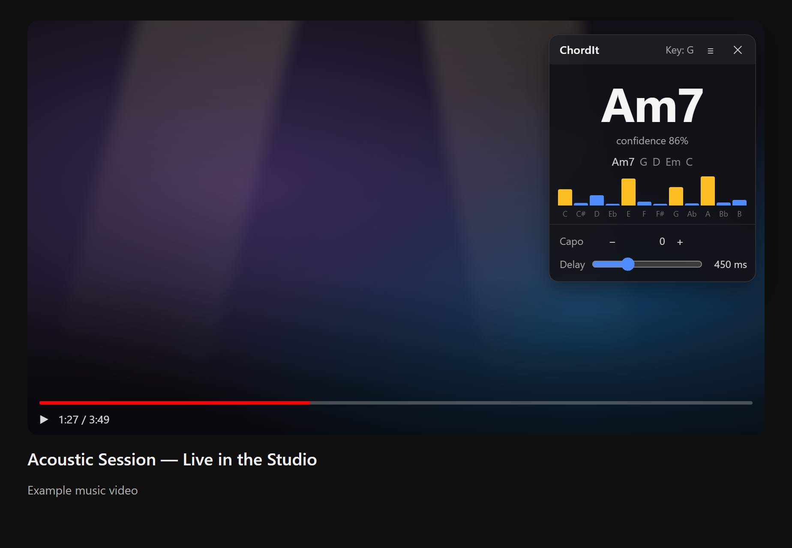

# ChordIt

Chrome/Brave extension that listens to the current tab's audio and shows the chord being played, so you can play along with music videos.



## Install (unpacked)

1. Open `chrome://extensions` (or `brave://extensions`) and turn on **Developer mode**.
2. Click **Load unpacked** and pick the `src` folder.
3. Pin ChordIt to the toolbar.

## Use

Play a video, then click the ChordIt icon. An overlay shows the current chord, the detected key, recent chords and a pitch meter. Click the icon again (or ✕) to stop. The overlay can be dragged and follows the video into fullscreen.

- **Capo:** shows the chord *shape* to play with a capo on that fret. The actual chord is shown underneath.
- **Delay:** detection lags the music by roughly 0.4–0.6 s. Delaying the audio by about that much makes the chords line up with what you hear. The video picture will then run slightly ahead of the sound.

## How it works

- `background.js`: the service worker. A toolbar click gets a `tabCapture` stream id, opens the offscreen document, injects the overlay and relays results.
- `offscreen.js`: captures the tab audio, plays it back (capturing mutes the tab) through an optional delay, and runs an FFT every 100 ms.
- `chords.js`: finds spectral peaks, removes 3rd/5th harmonics, builds a 12-bin chroma and smooths it. It then matches the chroma against major, minor, 7, maj7, m7, sus4 and dim templates. Diatonic chords and a matching bass note get a bonus, and hysteresis keeps the display from flickering. It also estimates the tuning offset and the key (Krumhansl profiles).
- `content.js`: the overlay UI, in a shadow DOM.

## Develop

```
npm test                          # detector tests on synthetic spectra
powershell tools/make-icons.ps1   # regenerate icons
powershell tools/screenshot.ps1   # regenerate docs/screenshot.png (headless Chrome/Brave)
```

After editing, click the reload icon on the extension card in `chrome://extensions`.
